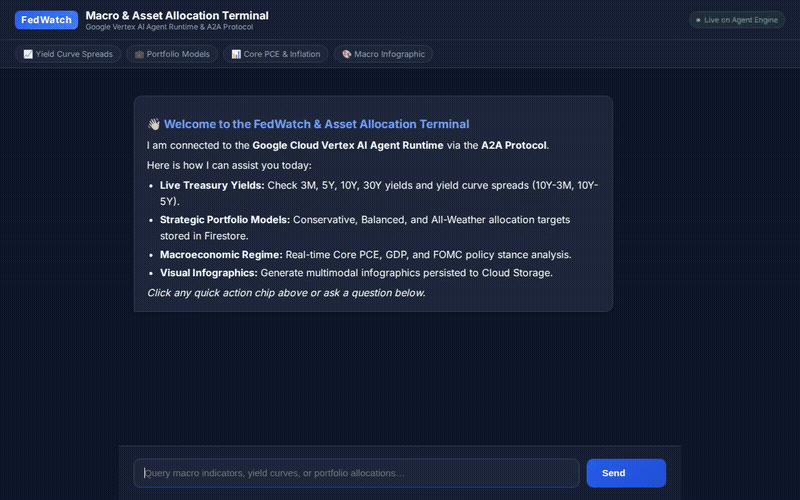

# FedWatch & Asset Allocator

An institutional macroeconomic strategist and asset allocation advisory agent powered by the **Google Agent Development Kit (ADK)**, **Gemini 2.5**, and the **A2A (Agent-to-Agent) Protocol**.

The agent connects real-time Treasury yield curves and macroeconomic policy indicators with target asset allocation models to provide actionable, regime-adaptive investment guidance.



---

## What the Agent Actually Does

The agent operates as a ReAct macro advisor with high-level multi-step reasoning (`ThinkingConfig(thinking_level=HIGH)`). When queried, it synthesizes market data, consults macroeconomic databases, recommends target portfolio weights, and generates visual infographics.

### Implemented Tools & Google Cloud Services

Based on `app/agent.py`, `app/firestore_tools.py`, `app/market_tools.py`, and `app/image_tools.py`, here are the tools and services wired into this agent:

| Capability | Tool Function | Backing Service / Library | Status |
| :--- | :--- | :--- | :--- |
| **Live Treasury Yields** | `fetch_live_treasury_yields` | `yfinance` (zero external key required) | **Active** |
| **Macro Indicators Catalog** | `get_macro_indicator`<br>`list_macro_indicators`<br>`update_macro_indicator` | **Google Cloud Firestore** (`macro_indicators` collection) | **Active** |
| **Portfolio Models** | `get_portfolio_model`<br>`list_portfolio_models` | **Google Cloud Firestore** (`portfolio_models` collection) | **Active** |
| **User Portfolio Persistence** | `save_user_portfolio_allocation` | **Google Cloud Firestore** (`user_portfolios` collection) | **Active** |
| **Multimodal Infographics** | `generate_macro_infographic` | **Vertex AI Imagen** (`gemini-2.5-flash-image`) + **Google Cloud Storage** | **Active** |
| **St. Louis Fed Series** | `fetch_fred_macro_series` | St. Louis Fed FRED API | **Active** *(Optional key; graceful fallback)* |
| **Interactive Donut Charts** | Dynamic frontend renderer | Client-side **Chart.js** in terminal UI | **Active** |
| **Agent Interoperability** | A2A Protocol v1.0 | `@a2a-ai/client` / httpx A2A streaming | **Active** |

### Planned / Not Yet Implemented
* **Cross-Session Vertex AI Memory Bank:** *Planned, not yet implemented.* Sessions currently use in-memory state (`session_type: in_memory` in `agents-cli-manifest.yaml`).
* **Python Code Sandbox Execution:** *Planned, not yet implemented.* Quantitative stress-testing runs via local tool calculations.
* **Agent Engine A2UI Card Projection:** *Planned, not yet implemented.* Rich UI tables and interactive donut charts are currently rendered client-side in the web frontend.

---

## Architecture

```
┌────────────────────────────────────────────────────────┐
│                   Web Chat Terminal                    │
│    (FastAPI Proxy + Interleaved Chart.js Renderers)    │
└───────────────────────────┬────────────────────────────┘
                            │ A2A Protocol (Streaming)
┌───────────────────────────▼────────────────────────────┐
│          Google Vertex AI Agent Runtime (ADK)          │
│               Model: gemini-2.5-flash                  │
│       Reasoning: ThinkingConfig (HIGH level)           │
└──────┬────────────────────┬────────────────────┬───────┘
       │                    │                    │
┌──────▼───────┐     ┌──────▼───────┐     ┌──────▼───────┐
│ Market Data  │     │  Firestore   │     │ Cloud Storage│
│  Live Yields │     │ Macro Trends │     │ Infographics │
│ (3M, 5Y, 10Y)│     │ & Portfolios │     │  & Assets    │
└──────────────┘     └──────────────┘     └──────────────┘
```

---

## Local Setup & Development

### 1. Prerequisites
- Python 3.11+
- [uv](https://docs.astral.sh/uv/) package manager
- Google Cloud SDK (`gcloud`) authenticated to your GCP project
- Node.js & Playwright (only if re-recording demo videos)

### 2. Installation
Clone the repository and install dependencies using `uv`:

```bash
git clone https://github.com/kforkai28/buildwithgemini-fedwatch-and-asset-allocator.git
cd buildwithgemini-fedwatch-and-asset-allocator
uv sync
```

### 3. Environment Configuration
Create a `.env` file in the project root:

```bash
GOOGLE_CLOUD_PROJECT="<your-gcp-project-id>"
GOOGLE_CLOUD_REGION="us-central1"
# Optional: St. Louis Fed FRED API key
# FRED_API_KEY="your-fred-api-key"
```

Seed initial portfolio templates and macro indicators to Firestore:

```bash
uv run python seed_firestore.py
```

### 4. Running the Agent Locally

#### Option A: ADK Developer Playground
Run the local ADK developer UI with live hot-reloading:

```bash
uv run adk web --host 0.0.0.0 --port 8000 --reload_agents app
```

#### Option B: Standalone Web Chat Terminal
Launch the FastAPI web server hosting the terminal:

```bash
export PORT=8080
uv run python frontend/main.py
```

---

## Evaluation & Testing

Run the test suite and pre-flight evaluation against the macro benchmark dataset:

```bash
# Run unit and integration tests
uv run pytest tests/unit tests/integration

# Run pre-flight LLM evaluation
agents-cli eval --dataset eval_dataset.json
```

---

## Deployment Instructions

### Deploy Agent to Vertex AI Agent Runtime

```bash
agents-cli deploy --region us-central1
```

### Deploy Web Chat Frontend to Cloud Run

```bash
gcloud run deploy fedwatch-frontend \
  --source frontend \
  --region us-central1 \
  --platform managed \
  --allow-unauthenticated \
  --set-env-vars AGENT_DIRECTORY="app"
```

---

## License
Licensed under the Apache License, Version 2.0.
